# pixel-gaussian-splat-maker

키워드로 픽셀아트 3D 가우시안 스플랫을 만들고, 기존 3DGS 파일을 픽셀화해 표준 포맷으로 내보내는 단일 페이지 도구입니다. 서버와 빌드 과정 없이 정적 파일(`index.html`, `css/`, `js/`)만으로 동작합니다.

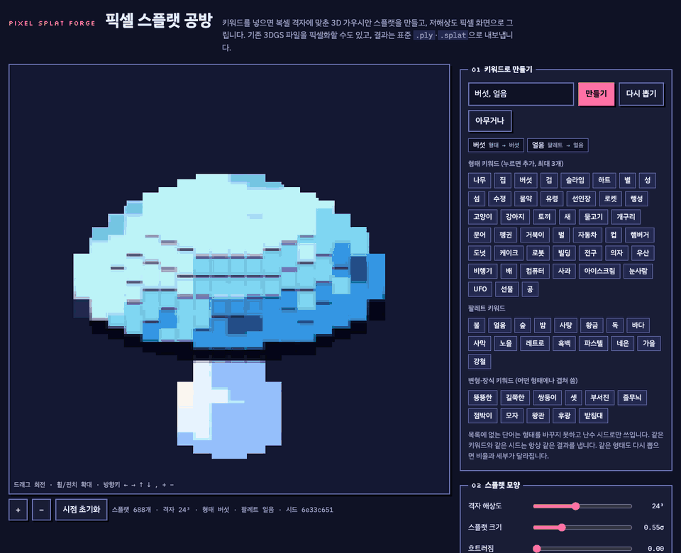

## 빠르게 써 보기

1. `index.html`을 브라우저로 엽니다.
2. 키워드 칸에 `고양이, 왕관`처럼 **형태 + 팔레트·변형·장식**을 쉼표로 적고 `만들기`를 누릅니다. 아래 단추를 눌러 키워드를 붙여도 됩니다.
3. 드래그로 돌려 보고, `픽셀아트로 보기` / `원래 가우시안으로 보기`로 화면을 바꿔 봅니다.
4. `스플랫 ZIP 저장`으로 `.ply`와 `.splat`을 받습니다.

## 예시

아래 키워드를 그대로 넣으면 같은 결과가 나옵니다(격자 24³, 기본 설정).

| `고양이, 왕관` | `성, 노을` | `로켓, 네온` | `버섯, 얼음` |
| :---: | :---: | :---: | :---: |
| 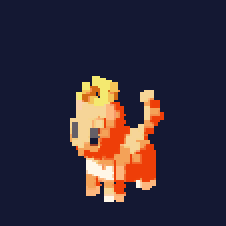 | 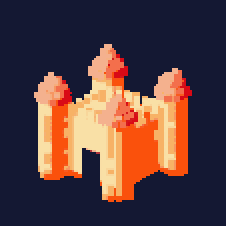 | 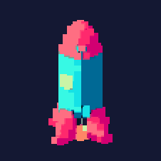 | 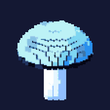 |
| `문어, 바다` | `도넛, 사탕` | `로봇, 강철` | `선인장, 사막, 모자` |
| 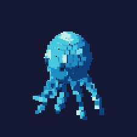 | 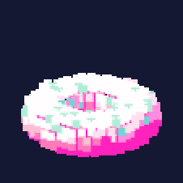 | 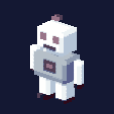 | 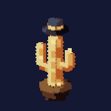 |

### 픽셀아트로 보기 vs 원래 가우시안으로 보기

같은 스플랫 데이터(`고양이, 왕관`)를 그리는 방식만 바꾼 것입니다. 왼쪽이 픽셀 화면, 오른쪽이 일반 가우시안 화면입니다.

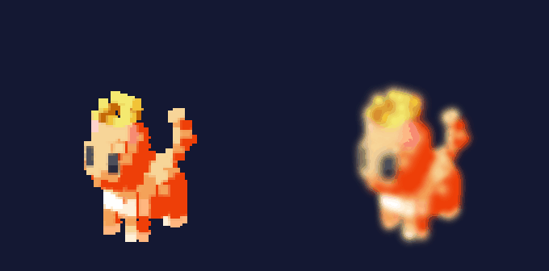

### 움직임

`슬라임, 사탕`에 움직임을 준 모습입니다. 8종 가운데 4종입니다.

| 깡충깡충 | 말랑말랑 | 물결 | 흩어졌다 모이기 |
| :---: | :---: | :---: | :---: |
| 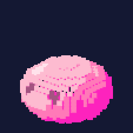 | 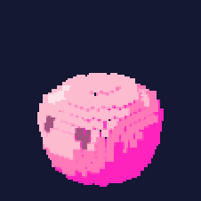 | 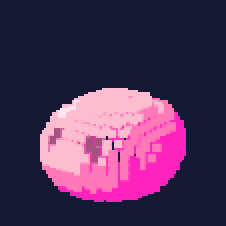 | 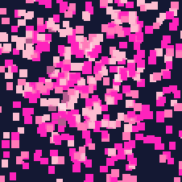 |

## 실행

`index.html`을 브라우저에서 엽니다(`css/`, `js/` 폴더가 같은 위치에 있어야 합니다). WebGL 2.0을 지원하는 브라우저가 필요합니다. 글꼴만 Google Fonts에서 불러오며, 그 외 외부 의존성은 없습니다.

## 기능

- **키워드 생성**: 형태 44종(판타지 소품, 생물, 일상·탈것·음식), 팔레트 16종, 변형 7종, 장식 4종을 조합합니다. 목록에 없는 단어는 난수 시드로만 쓰입니다. 같은 키워드와 같은 시드는 같은 결과를 냅니다.
- **스플랫 모양**: 격자 해상도(12³~40³), 크기(σ), 흐트러짐, 불투명도.
- **픽셀 렌더링**: 저해상도 버퍼에 알파 합성 후 최근접 확대. 경계 단단함, 사각 정도, 색 단계, 디더링, 직교 투영.
- **움직임 8종**: 화면에서 스플랫 중심을 매 프레임 옮깁니다. 내보낸 스플랫 파일에는 들어가지 않습니다.
- **3DGS 파일 픽셀화**: `.ply`(binary_little_endian) 또는 `.splat`을 복셀 평균색과 k-means 팔레트로 다시 만듭니다.
- **내보내기**: ZIP(`.ply` + `.splat` + `README.txt`), PNG, 영상 녹화(WebM 또는 MP4).

## 여기서 말하는 픽셀아트 가우시안 스플랫

표준으로 정해진 포맷이 아니라 이 도구의 정의입니다.

1. 가우시안 중심을 N³ 복셀 격자에 맞추고 겉면 칸마다 스플랫 하나를 둡니다.
2. 색은 슬롯 4개 × 명암 3단계로 제한하고, 명암은 격자 법선과 고정 광원으로 미리 굽습니다.
3. 화면은 저해상도 버퍼에 뒤에서 앞으로 알파 합성한 뒤 최근접 보간으로 키웁니다.

데이터 자체는 위치·스케일·회전·불투명도·색을 가진 일반 3D 가우시안입니다. 단단한 경계와 사각 모양은 이 화면의 셰이더 효과라서, 내보낸 파일을 다른 뷰어에서 열면 부드러운 가우시안으로 보입니다.

## 내보내기 포맷

- `.ply`: INRIA 3D Gaussian Splatting 형식, float32 17개(`x y z nx ny nz f_dc_0..2 opacity scale_0..2 rot_0..3`). 색 = 0.5 + 0.28209479 × f_dc, 불투명도 = sigmoid(opacity), 스케일 = exp(scale), 회전 = (w, x, y, z). 구면조화는 0차만 있습니다.
- `.splat`: [antimatter15/splat](https://github.com/antimatter15/splat) 형식, 스플랫당 32바이트.
- 좌표계는 Y가 위쪽입니다. Y가 아래인 뷰어용으로 X축 180° 회전 옵션이 있습니다.

## 확인되지 않은 것

- 외부 뷰어(SuperSplat, antimatter15 뷰어 등)에서 내보낸 파일을 열어 보지 않았습니다.
- 실제로 학습된 3DGS 파일의 픽셀화는 시험하지 않았습니다. 이 도구가 만든 파일로만 왕복 시험했습니다.
